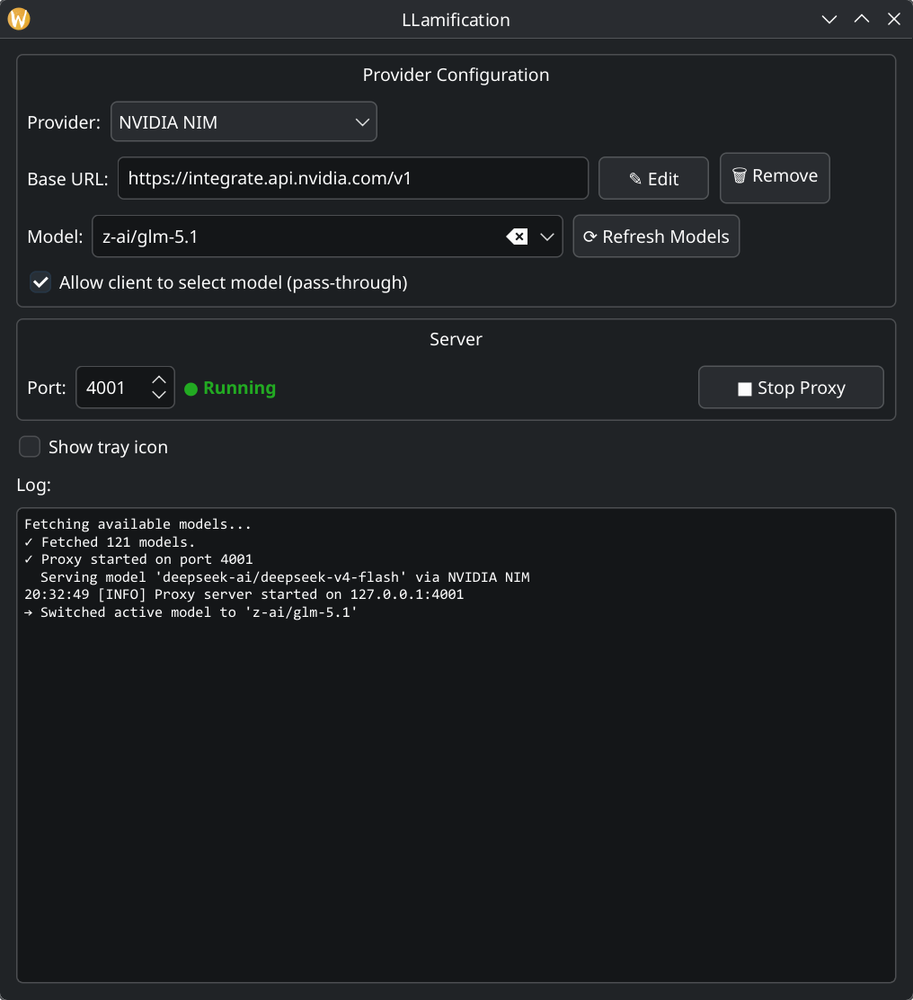

# LLamification



LLamification is a lightweight local proxy that makes any online LLM provider look like a local Ollama server. You configure it once with your provider's API endpoint and key, then point any Ollama-compatible tool (CLI, library, UI) at `http://localhost:4001` and it just works.

You can switch providers and models on the fly without restarting anything.

## Why this exists

I wanted something simpler than litellm for my use case: connecting online LLMs and making them pretend to be local Ollama. LLamification does exactly that -- no more, no less. It also lets you switch providers and models without touching config files or restarting services.

## Quick start

```bash
#For Arch Linux users, app is available on AUR

# Clone the repository
git clone https://github.com/magillos/LLamification.git
cd LLamification

# Install dependencies (pick one)

# Option A: Use your distro's package manager
#   Debian/Ubuntu: sudo apt install python3-pyqt6 python3-aiohttp python3-pyqt6.qtsvg
#   Fedora:        sudo dnf install python3-qt6 python3-aiohttp
#   Arch:          sudo pacman -S python-pyqt6 python-aiohttp

# Option B: Use pip inside a virtual environment (recommended for isolation)
python3 -m venv .venv
source .venv/bin/activate
pip install PyQt6 aiohttp

# Run the GUI to configure your provider, API key, and model
python3 -m llamification -g

# Start the proxy with your last settings (headless mode)
python3 -m llamification
```

### Optional alias

Add this to your `~/.bashrc` or `~/.zshrc`:

```bash
alias llamification="cd /path/to/LLamification && python3 -m llamification"
```

Then you can start the proxy by just typing `llamification` in your terminal.

## Usage

1. Run `python3 -m llamification -g` to open the GUI.
2. Add a provider (name, base URL, API key), then click "Refresh Models" to fetch the available models.
3. Select a model and click "Start Proxy".
4. The proxy now runs on `http://localhost:4001` and speaks both the Ollama API and the OpenAI-compatible API.

The next time you run `python3 -m llamification` (without the `-g` flag), it starts headlessly with your last settings.

The default port is `4001` so you can run it alongside a real Ollama server without conflicts. Change the port in the GUI or in `~/.config/llamification/config.json`.

### Supported endpoints

**Ollama-compatible:**

| Method | Path | Description |
|--------|------|-------------|
| GET  | `/`              | Health check ("Ollama is running") |
| GET  | `/api/tags`       | List available models |
| POST | `/api/generate`   | Generate text |
| POST | `/api/chat`       | Chat completion |
| POST | `/api/embeddings` | Embeddings (proxied to upstream) |

**OpenAI-compatible:**

| Method | Path | Description |
|--------|------|-------------|
| GET  | `/v1`                 | Health check |
| GET  | `/v1/models`           | List available models |
| POST | `/v1/chat/completions` | Chat completion (with function-calling / tools support) |
| POST | `/v1/embeddings`       | Embeddings (proxied to upstream) |

### Tool / function calling

`/v1/chat/completions` transparently passes the `tools` and `tool_choice` fields from the request to the upstream provider, and forwards any `tool_calls` in the response — both streaming and non-streaming. This means agentic clients like Cline, Continue, and Roo Code can use tools through the proxy without modification.

### Reasoning output

Some upstream models (llama.cpp's `llama-server` with `--reasoning-format deepseek`, DeepSeek, and others) return a `reasoning_content` field next to `content`. LLamification forwards it unchanged on `/v1/chat/completions` (non-streaming `message` and streaming `delta`), so clients that understand it keep working; clients that only read `content` are unaffected. The Ollama routes ignore it.

If the model spends its whole answer budget thinking, `content` can be empty. Three optional settings in `~/.config/llamification/config.json` control this (all disabled by default):

| Key | Effect |
|-----|--------|
| `strip_reasoning` | never forward `reasoning_content` to the client |
| `fallback_to_reasoning` | if `content` is empty and `reasoning_content` is not, return the reasoning as `content` and log a warning |
| `debug_raw` | log the raw upstream body and the exact response sent to the client (contains your prompts) |

`strip_reasoning` and `fallback_to_reasoning` can be overridden per provider and per model in `model_settings`, and each entry may carry an `extra_body` object that is merged into the upstream request JSON. Client-supplied fields win unless their key (or dotted path) is listed in `force_extra_body`:

```json
"model_settings": {
  "custom:cp1": {
    "*": { "fallback_to_reasoning": true },
    "Qwen3-4B": {
      "extra_body": {
        "chat_template_kwargs": { "enable_thinking": false },
        "thinking_budget_tokens": 4096
      },
      "force_extra_body": ["thinking_budget_tokens"]
    }
  }
}
```

Precedence is per-model entry, then the provider's `"*"` entry, then the global key. `debug_raw` can also be enabled with `python -m llamification --debug-raw`.

## Configuration

All configuration is stored in `~/.config/llamification/config.json`. Use the GUI to add providers, set API keys, select models, and mark favourites. No manual editing required.

## License

MIT
